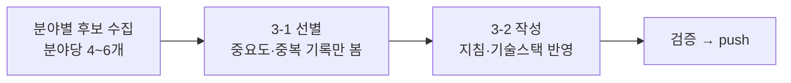

## 문제: "내 스택을 적었더니 내 스택 얘기만 온다"

데일리 리포트 서버의 받아보기 설정에는 자유 입력 **추가 지침**이 있다. 개발자라면 자연스럽게 이렇게 쓰게 된다.

```
내 기술스택은 Java·Spring, Docker·Kubernetes다.
```

이렇게 쓰면 결과가 더 잘 맞을 것 같지만, 모델은 이 문장을 "이 사람한테 맞는 걸 **골라라**"로 받아들인다. 그러면 이런 일이 생긴다.

- 백엔드 이슈 3개가 전부 Spring 이야기가 된다.
- Go, Rust, 새 도구 소식이 빠지고, 날마다 반복되면서 시야가 점점 좁아진다.
- 소식이 적은 날에는 별거 아닌 Spring 마이너 패치가 다른 생태계의 큰 소식을 밀어낸다.

받아보기 서비스의 가치는 **내가 몰랐던 걸 알게 되는 것**인데, 개인화가 오히려 그걸 갉아먹는 셈이다.

## 지침으로 막아보기 (부족함)

먼저 지침 문구로 막는 방법을 생각했다.

```
이슈 선별은 스택과 무관하게 중요도 순으로 해줘.
분야마다 최소 1개는 내 스택 밖의 이슈로 골라줘.
```

어느 정도는 통한다. 하지만 결국 **모델이 지침을 해석하는 방식에 맡기는 것**이라 결과가 들쭉날쭉하다. 사용자마다 지침을 이렇게 잘 쓰리라고 기대할 수도 없다.

## 구조로 막기: 선별과 작성을 나눈다

예약 작업 프롬프트를 두 단계로 쪼갰다.



**3-1 선별** — 사용자 지침은 보지 않는다
- 분야별로 후보를 넉넉히 모으고 중요도(파급력, 공식 발표 여부, 여러 매체 보도)로 순서를 매긴다.
- 후보마다 지난 주제 기록(`covered_topics`)과 대조한다. 같은 사건이면 기존 키를 다시 쓰고, 새 소식이 없으면 버린다.
- 한 사건이 두 분야에 걸치면 더 맞는 분야 하나에만 넣는다.

**3-2 작성** — 여기서만 지침을 반영한다
- 지침은 "어떤 관점으로, 무엇을 더 자세히 쓸지"로만 쓴다.
- 지침 때문에 3-1에서 고른 이슈를 바꾸지 않는다.

이렇게 하면 지침이나 스택을 적어도 **무엇을 받는지는 그대로 두고, 어떻게 쓰이는지만** 달라진다.

> 이 구조로 바꾸면 기존 지침 중 "~위주로 골라줘" 같은 문장은 효과가 없어진다. 프리셋 지침도 "고르는 기준"이 아니라 "쓰는 관점"으로 다시 썼다.
{: .prompt-tip }

## 그래도 좁히고 싶은 사람: 반영 방식을 사용자가 고르게

일부러 자기 스택 위주로 받고 싶은 사람도 있다. 그래서 기술스택을 지침에서 떼어 **별도 칸**으로 만들고, 선별 단계에 영향을 주는 정도를 사용자가 직접 고르게 했다.

| 방식 | 선별 단계 | 작성 단계 |
|---|---|---|
| 관점만 (기본값) | 스택과 무관하게 중요도 순 | 스택 이슈는 자세히, 다른 스택 이슈에는 비교 한 줄 |
| 우선 | 분야마다 개수의 절반(내림)까지 스택 관련 먼저 | 위와 같음 |
| 집중 | 스택 관련 위주 | 위와 같음 |

```python
STACK_MODES = {
    "perspective": {"name": "관점만", "desc": "받는 이슈는 그대로, 설명만 내 스택 기준으로 (추천)"},
    "prefer":      {"name": "우선",   "desc": "분야마다 절반까지 내 스택 관련 이슈로 채움"},
    "focus":       {"name": "집중",   "desc": "내 스택 관련 이슈 위주로 채움(다른 스택 소식은 줄어요)"},
}
```

"집중"의 설명에 **"다른 스택 소식은 줄어요"**를 굳이 적어둔 이유가 있다. 시야가 좁아지는 걸 알고 고르게 하기 위해서다. 기본값은 가장 넓게 받는 "관점만"으로 뒀다.

## 지침의 역할을 좁히면 생기는 효과

정리하고 보니 설정 항목마다 맡는 일이 분명해졌다.

| 설정 | 결정하는 것 | LLM 재량 |
|---|---|---|
| 분야·개수 | 무엇을, 얼마나 | 없음 (검증이 개수 초과를 막음) |
| 형식 | 이슈 하나의 깊이 | 없음 (검증이 일치 여부 확인) |
| 기술스택 + 반영 방식 | 선별 가중치 (정해진 규칙) | 적음 |
| 추가 지침 | 쓰는 관점 | 큼 |

LLM 재량이 큰 항목(자유 지침)일수록 **결과에 미치는 범위를 좁히고**, 범위가 큰 항목(무엇을 받을지)은 **숫자와 규칙으로 고정**했다. 예전에는 "IT·개발" 한 분야 안에서 백엔드냐 프론트냐를 지침 문구로 갈랐는데, 이번에 분야를 4개로 나눠 숫자로 정하게 바꾼 것도 같은 이유다.

## 비용

생성은 구독 플랜의 예약 작업이 하고, 사용자도 5명 미만이라 단계를 나눠도 비용은 거의 늘지 않는다. 늘어나는 건 후보를 넉넉히 모으는 검색량 정도다. 정말 비용을 걱정해야 하는 건 단계 수가 아니라 **검증 실패로 인한 재시도**였고, 이건 [중복 검사 글](/posts/llm-report-dedup-rules/)에서 정리한 경고 모드로 묶어뒀다.
