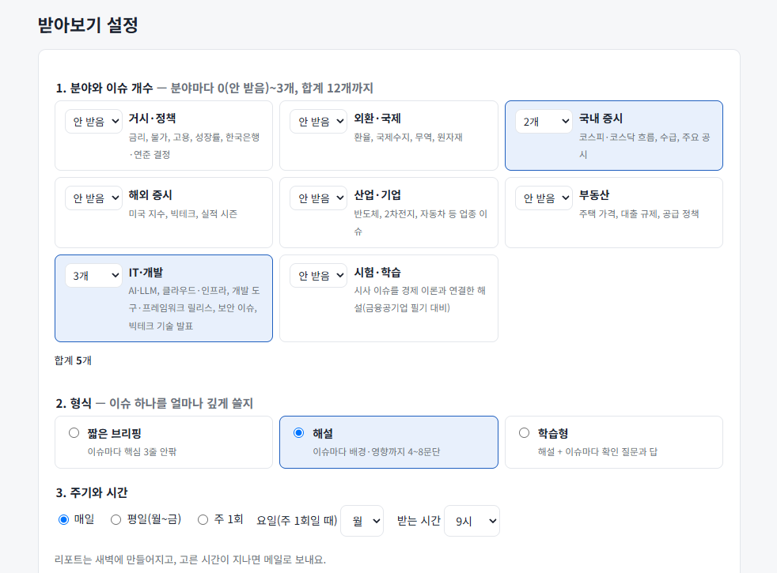
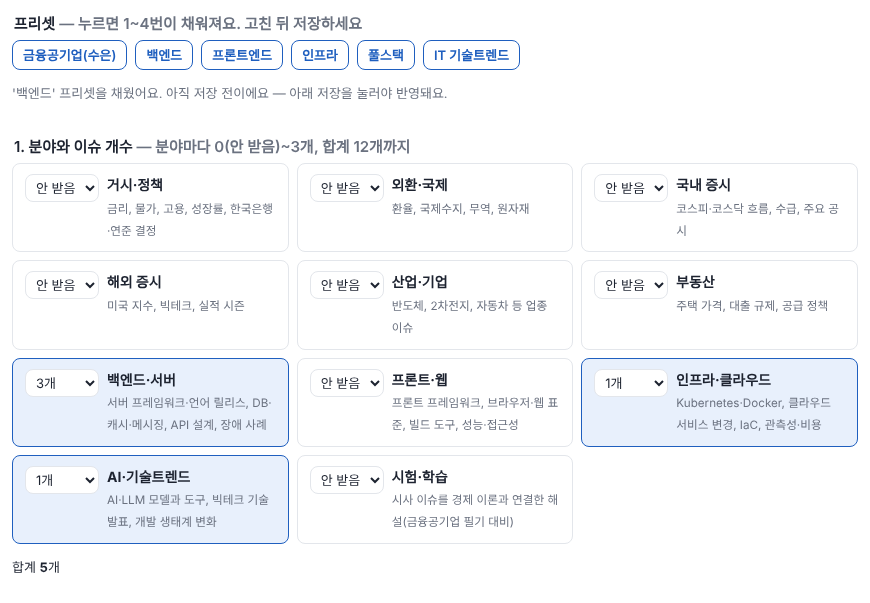

## 왜 나눴나

받아보기 설정에서는 분야마다 이슈를 0~3개(합계 12개까지) 고른다. 그런데 "IT·개발"이 한 칸뿐이었다.

{: width="982" height="725" }
_개편 전: 개발 관련 분야가 "IT·개발" 하나뿐이고 최대 3개_

- 받는 사람 대부분이 개발자인데, 가장 큰 관심사가 한 칸에 몰려 있고 **최대 3개로 막혀** 있었다.
- 백엔드 개발자와 프론트 개발자가 사실상 같은 리포트를 받았다. 차이는 자유 지침 문구에서만 났다.

지침은 "이런 걸 골라줘"라는 부탁이라 결과가 들쭉날쭉하다. 분야 개수로 정하면 **검증 스크립트가 강제할 수 있다.** 그래서 IT·개발을 4개로 나눴다.

```python
CATEGORIES = {
    ...
    "backend":  {"name": "백엔드·서버",     "desc": "서버 프레임워크·언어 릴리스, DB·캐시·메시징, API 설계, 장애 사례"},
    "frontend": {"name": "프론트·웹",       "desc": "프론트 프레임워크, 브라우저·웹 표준, 빌드 도구, 성능·접근성"},
    "infra":    {"name": "인프라·클라우드", "desc": "Kubernetes·Docker, 클라우드 서비스 변경, IaC, 관측성·비용"},
    "ai_trend": {"name": "AI·기술트렌드",   "desc": "AI·LLM 모델과 도구, 빅테크 기술 발표, 개발 생태계 변화"},
}
```

{: width="870" height="603" }
_개편 후: 개발 분야 4개 + 맨 위 프리셋 버튼. "백엔드" 프리셋을 누른 상태_

보안은 따로 분야를 두지 않았다. 같은 CVE가 보안 분야와 해당 기술 분야에 동시에 들어가기 쉬워서, 각 분야에서 관련 CVE를 다루도록 했다.

## 문제: 이미 저장된 `it`

분야 key는 앱과 예약 작업이 주고받는 파일 형식의 일부다. 그런데 `it`라는 key가 두 군데에 이미 남아 있었다.

1. **구독 설정**(SQLite `subscriptions.categories`, JSON `{"it": 3, "macro": 1}`)
2. **지난 리포트**(가져온 리포트 JSON의 `sections[].category`)

### 설정: 읽는 시점에 변환

DB를 한 번에 고치는 마이그레이션 스크립트 대신, **읽을 때 새 분야로 나눠 담는** 방식을 택했다. 이 함수는 원래 아주 예전 형식(분야 배열)도 읽고 있었으니, 같은 자리에 규칙 하나를 더 얹은 셈이다.

```python
LEGACY_IT_SPLIT = {          # 합계 유지
    1: {"ai_trend": 1},
    2: {"backend": 1, "ai_trend": 1},
    3: {"backend": 2, "ai_trend": 1},
}

def parse_categories(raw) -> dict:
    val = json.loads(raw) if isinstance(raw, str) else (raw or {})
    if isinstance(val, list):                       # 아주 예전 형식
        val = {c: DEFAULT_CATEGORY_COUNT for c in val}
    out = {c: int(n) for c, n in val.items() if c in CATEGORIES and int(n) > 0}
    legacy = min(int(val.get("it") or 0), CATEGORY_COUNT_MAX)
    for c, n in LEGACY_IT_SPLIT.get(legacy, {}).items():
        out[c] = min(out.get(c, 0) + n, CATEGORY_COUNT_MAX)   # 분야당 상한 유지
    return out
```

이렇게 하면 좋은 점이 있다.

- 배포 순서를 신경 쓸 필요가 없다. 앱이 뜨는 순간부터 요청 파일에는 새 key만 나간다.
- 사용자가 설정을 다시 저장하면 새 형식으로 자연스럽게 굳는다.
- 롤백하더라도 DB는 그대로다.

### 지난 리포트: 표시용 라벨만 남긴다

지난 리포트를 고쳐 쓰는 건 위험하다. 대신 **고를 수 있는 분야**와 **표시할 수 있는 분야**를 나눴다.

```python
LEGACY_CATEGORIES = {"it": {"name": "IT·개발", "desc": "(예전 분야) 백엔드·프론트·인프라·AI로 나뉨"}}
CATEGORY_LABELS = {**CATEGORIES, **LEGACY_CATEGORIES}
```

- 설정 화면과 새 리포트 검증은 `CATEGORIES`를 쓴다. 그래서 `it`는 더 이상 고를 수도, 새로 만들 수도 없다.
- 리포트 화면·메일·주제 모아보기는 `CATEGORY_LABELS`를 쓴다. 그래서 지난 리포트의 `it`는 "IT·개발"로 그대로 보인다.

e2e 테스트에는 DB에 `it` 분야 리포트를 직접 넣고 화면과 메일을 렌더링하는 시나리오를 추가했다. 표시용 dict에서 key 하나만 빠져도 `KeyError`로 페이지가 통째로 죽기 때문이다.

## 프리셋 버튼

분야가 11개로 늘면서 처음 설정하는 사람의 부담도 커졌다. 그래서 자주 쓸 조합을 프리셋으로 묶었다.

| 프리셋 | 분야(개수) | 형식 | 주기 |
|---|---|---|---|
| 금융공기업 | 외환·국제 3, 거시·정책 2, 산업·기업 2, 시험·학습 2 | 학습형 | 매일 |
| 백엔드 | 백엔드 3, 인프라 1, AI 1 | 해설 | 평일 |
| 프론트엔드 | 프론트 3, 백엔드 1, AI 1 | 해설 | 평일 |
| 인프라 | 인프라 3, 백엔드 1, AI 1 | 해설 | 평일 |
| 풀스택 | 백엔드 2, 프론트 2, 인프라 1, AI 1 | 해설 | 평일 |
| IT 기술트렌드 | AI 3, 해외 증시 1, 산업·기업 1 | 짧은 브리핑 | 매일 |

설계할 때 정한 원칙은 다음과 같다.

- **개발 프리셋은 주력 분야 3개 + 옆 분야 1~2개.** 해설형은 이슈 하나가 길어서 합계를 5~6개로 잡았다.
- **버튼은 폼만 채우고, 저장은 사용자가 직접.** 지금 설정을 실수로 덮어쓰지 않게 하려는 것이다. 이미 써둔 지침이 있으면 덮어쓰기 전에 확인을 받는다.
- **기술스택은 건드리지 않는다.** 개인 정보라서 프리셋이 바꿀 대상이 아니다.

구현은 서버 상수를 그대로 JSON으로 템플릿에 넘겨, 바닐라 JS로 폼을 채운다.

```html
<script>
  var PRESETS = {{ PRESETS | tojson }};
  function applyPreset(key) {
    var p = PRESETS.find(function (x) { return x.key === key; });
    var f = document.getElementById("cfg");
    var g = f.elements["guideline"];
    if (g.value.trim() && g.value.trim() !== p.guideline &&
        !confirm("추가 지침을 '" + p.label + "' 프리셋 지침으로 바꿀까요?")) return;
    f.querySelectorAll("select.count").forEach(function (s) {
      s.value = String(p.categories[s.name.slice(6)] || 0);   // name="count_backend"
      s.parentElement.classList.toggle("on", s.value !== "0");
    });
    // format · frequency · send_hour · guideline 도 같은 방식
    updateTotal();
  }
</script>
```

프리셋 값이 잘못되면(없는 분야, 상한 초과, 없는 시간대) 버튼이 저장할 수 없는 폼을 만든다. 그래서 **모든 프리셋을 실제 저장 검증 함수에 통과시키는 테스트**를 넣었다.

```python
for p in PRESETS:
    form = {f"count_{k}": str(n) for k, n in p["categories"].items()}
    form.update(format=p["format"], frequency=p["frequency"],
                send_hour=str(p["send_hour"]), guideline=p["guideline"])
    assert services.normalize_subscription(form)["categories"] == p["categories"]
```

## 남은 일

- 프리셋은 지금 코드 상수(`config.PRESETS`)에 있다. 관리자 화면에서 수정할 일이 잦아지면 SQLite로 옮길 예정이다.
- 기술스택 칸과 반영 방식(관점만·우선·집중)이 왜 필요했는지는 [선별/작성 분리 글](/posts/llm-select-then-write/)에 따로 정리했다.
