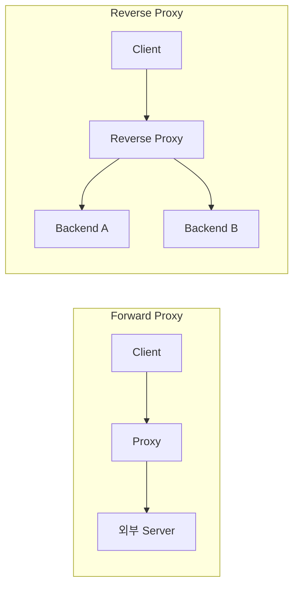
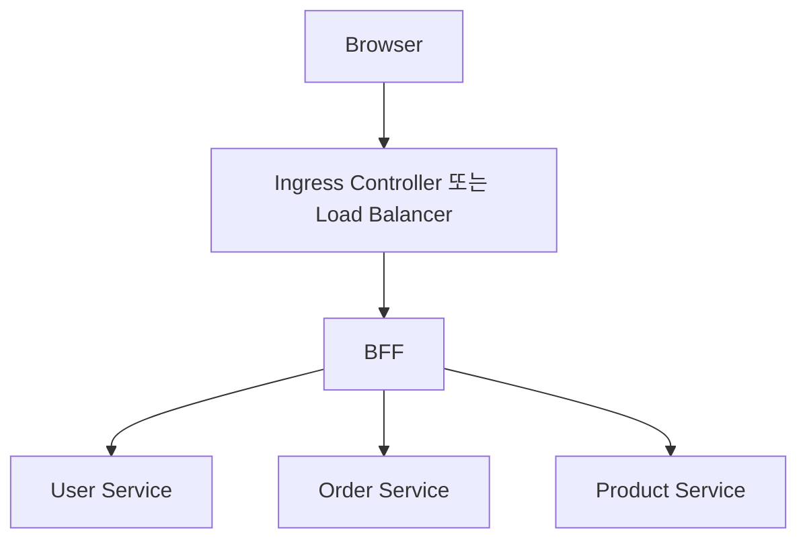
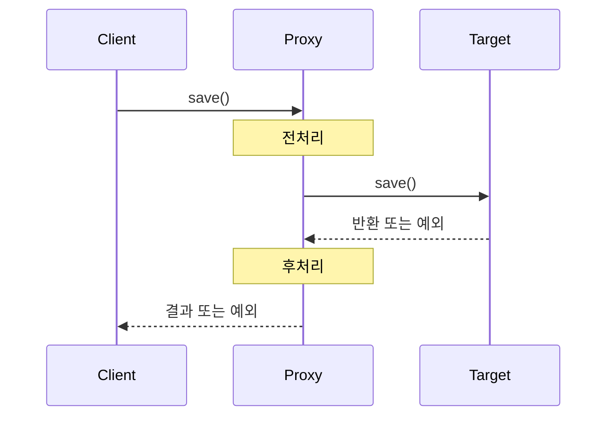
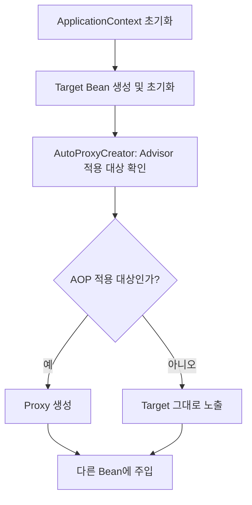
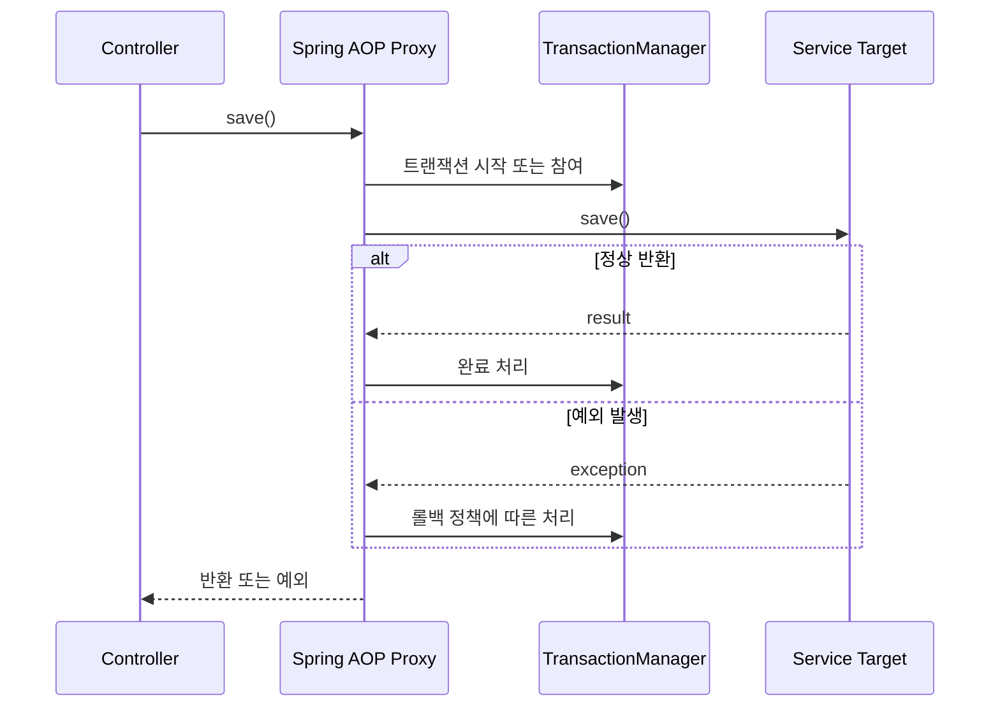
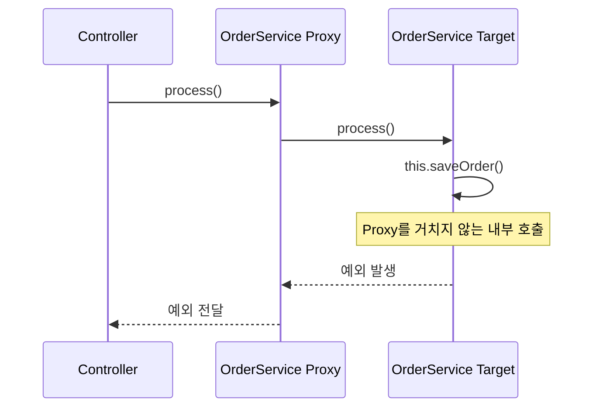
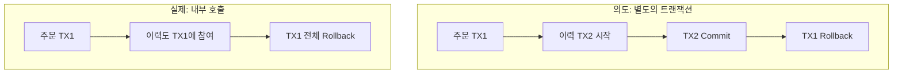
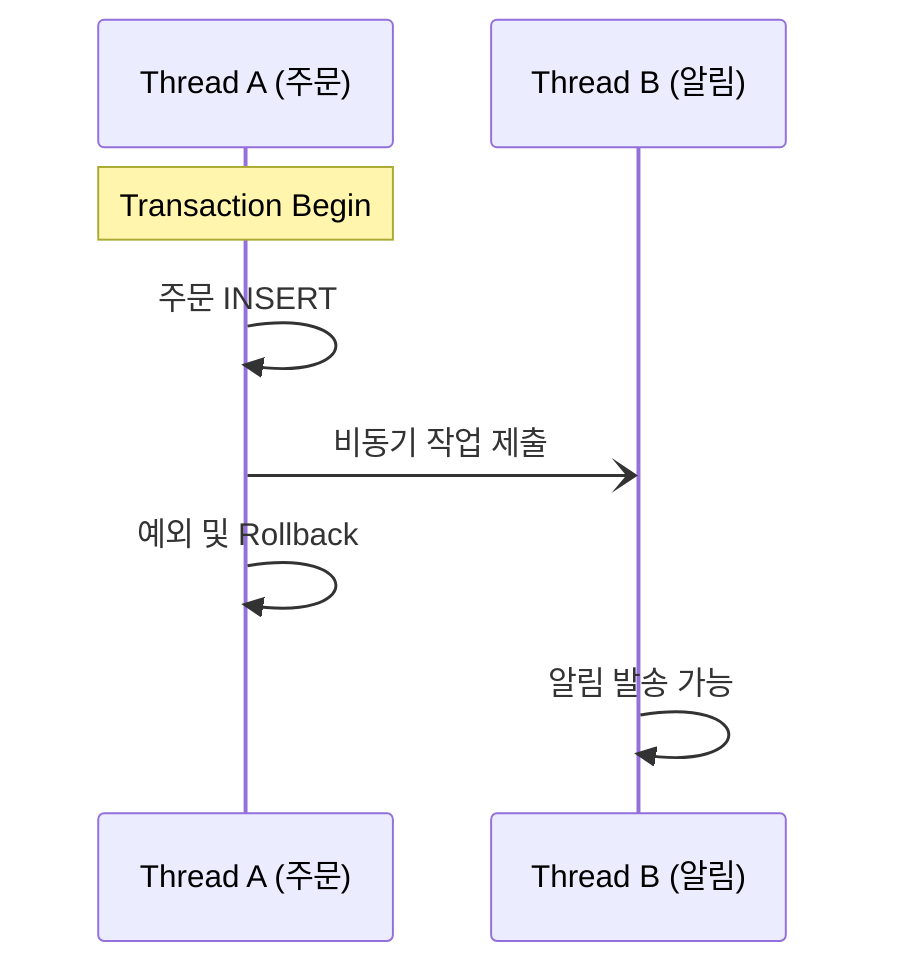
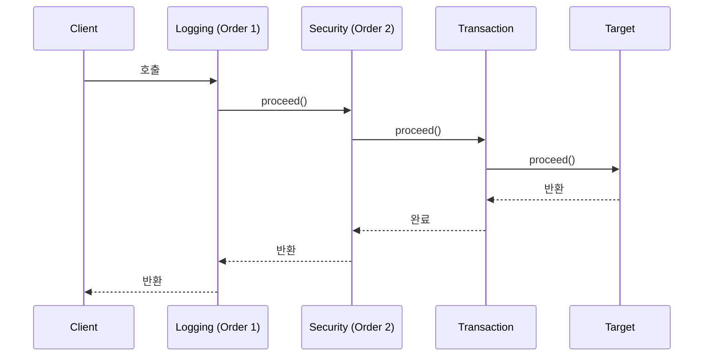
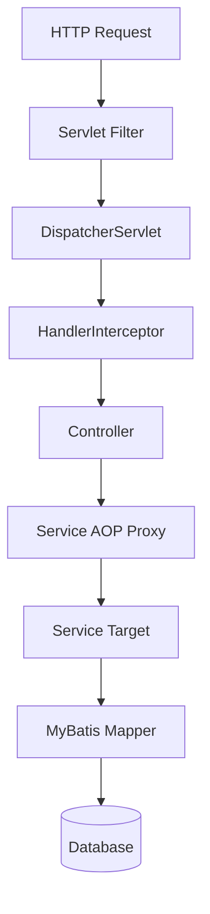

## 들어가며

네트워크에서는 Nginx나 Ingress를 프록시라고 부르고, Spring에서는 `@Transactional`을 처리하는 객체도 프록시라고 부른다. 동작하는 계층은 다르지만 본질은 같다. **실제 대상에 대한 접근을 중간 대리자가 처리한다**는 것이다.

이 개념을 이해하면 `@Transactional`을 선언했는데 롤백되지 않거나, `@Async`를 붙였는데 동기적으로 동작하는 이유도 설명할 수 있다.

이 글은 Spring Boot 3.x / Spring Framework 6.x, Spring MVC, MyBatis, JDBC 기반 트랜잭션 및 기본 프록시 모드를 전제로 한다. 예제는 원리 설명용으로 일부 의존성과 import를 생략했다.

## 1. Forward Proxy와 Reverse Proxy

Forward Proxy는 클라이언트의 외부 접근을 대신하고, Reverse Proxy는 서버 앞에서 요청을 수신하여 내부 서버로 전달한다.



| 구분 | Forward Proxy | Reverse Proxy |
|---|---|---|
| 대리 대상 | 클라이언트 | 서버 |
| 주된 트래픽 관점 | Outbound | Inbound |
| 주요 목적 | 외부 접근 정책, 요청 중계, 캐싱 | 라우팅, TLS 종료, 로드 밸런싱 |
| 예시 | 사내 인터넷 프록시, Squid | Nginx, HAProxy, Envoy |

IP 은닉은 구성에 따라 달라진다. 프록시가 원본 주소를 헤더로 전달할 수도 있으므로 반드시 익명성이 보장되는 것은 아니다.

Kubernetes 환경에서는 다음과 같은 구조를 흔히 볼 수 있다.



Ingress는 라우팅 규칙을 정의하는 Kubernetes 리소스이며, 이를 구현하는 컨트롤러 또는 외부 로드 밸런서가 실제 리버스 프록시 역할을 담당한다. BFF는 요청 중계 외에도 세션 관리, 응답 가공, 데이터 집계 등의 애플리케이션 로직을 수행할 수 있다.

## 2. Java의 프록시 객체

객체 수준의 프록시는 실제 객체 대신 메서드 호출을 받는다. Target의 코드에 손대지 않고 호출 전후에 필요한 기능을 추가할 수 있다.



### 정적 프록시

```java
public interface UserService {
    void save();
}

public class UserServiceImpl implements UserService {
    @Override
    public void save() {
        System.out.println("사용자 저장");
    }
}

public class UserServiceProxy implements UserService {
    private final UserService target;

    public UserServiceProxy(UserService target) {
        this.target = target;
    }

    @Override
    public void save() {
        System.out.println("호출 전 처리");
        try {
            target.save();
        } finally {
            System.out.println("호출 후 처리");
        }
    }
}
```

```java
UserService service = new UserServiceProxy(new UserServiceImpl());
service.save();
```

실제 객체는 회원 저장에만 집중하고 프록시는 공통 기능을 담당한다. 직접 작성하는 프록시 클래스가 대상마다 늘어나는 문제는 동적 프록시로 해결할 수 있다.

### 동적 프록시

JDK는 `Proxy.newProxyInstance()`와 `InvocationHandler`를 통해 런타임에 인터페이스 기반 프록시를 생성할 수 있다. CGLIB는 대상 클래스를 상속하는 방식으로 프록시를 생성한다.

| 구분 | JDK Dynamic Proxy | CGLIB |
|---|---|---|
| 방식 | 인터페이스 구현 | 클래스 상속 |
| 호출 가능한 API | 프록시 인터페이스 기준 | 상속 가능한 대상 메서드 기준 |
| 인터페이스 필요 | 필요 | 불필요 |
| final 메서드 | 인터페이스 호출이라면 가능 | 오버라이딩 불가 |
| final 클래스 | 인터페이스 프록시는 가능 | 상속 불가 |

Spring Boot 3.x의 AOP 자동 설정은 기본적으로 클래스 기반 프록시를 선호한다. `spring.aop.proxy-target-class=false`로 인터페이스 기반 프록시를 우선하도록 설정할 수 있다. 인터페이스가 없는 대상은 클래스 기반 프록시가 필요하다.

## 3. AOP는 무엇을 분리하는가?

AOP(Aspect Oriented Programming)는 여러 객체에 걸쳐 반복되는 횡단 관심사(Cross-cutting Concern)를 비즈니스 로직으로부터 분리하는 설계 방식이다.

| 핵심 관심사 | 횡단 관심사 |
|---|---|
| 주문 생성 | 트랜잭션 관리 |
| 회원 등록 | 권한 검사 |
| 상품 조회 | 캐싱, 로깅, 실행 시간 측정 |

OOP와 AOP는 대체 관계가 아니다. OOP가 객체의 역할을 나누는 데 집중한다면 AOP는 여러 객체에 공통으로 적용할 정책을 분리한다.

### 주요 용어

| 용어 | 설명 |
|---|---|
| Aspect | 횡단 관심사를 모아 둔 모듈 |
| Advice | 특정 실행 지점에 적용하는 부가 동작 |
| Join Point | 부가 동작을 적용할 수 있는 지점. Spring AOP에서는 메서드 실행 |
| Pointcut | 적용할 Join Point를 선택하는 조건 |
| Advisor | Advice와 Pointcut을 결합하는 Spring AOP 구성 요소 |
| Target | 실제 비즈니스 객체 |
| Proxy | 메서드 호출을 가로채는 대리 객체 |
| Weaving | Aspect를 대상 동작에 결합하는 과정 |

### 실행 시간을 측정하는 Aspect

Spring Boot 프로젝트에 `spring-boot-starter-aop`를 추가하고 다음과 같이 작성할 수 있다.

```java
@Aspect
@Component
@Slf4j
public class LoggingAspect {

    @Around("execution(* com.example.service..*(..))")
    public Object measure(ProceedingJoinPoint joinPoint) throws Throwable {
        long start = System.nanoTime();
        try {
            return joinPoint.proceed();
        } finally {
            double elapsed = (System.nanoTime() - start) / 1_000_000.0;
            log.info("{} elapsed={}ms", joinPoint.getSignature(), elapsed);
        }
    }
}
```

`execution(...)`은 서비스 패키지 및 하위 패키지의 메서드를 선택한다. `proceed()`는 다음 Advice 또는 Target 메서드로 실행을 넘긴다. 호출하지 않으면 실제 메서드까지 도달하지 않을 수 있으므로 의도적으로 실행을 중단하는 경우가 아니라면 누락하지 않아야 한다.

| Advice | 동작 시점 |
|---|---|
| `@Before` | 실행 전 |
| `@AfterReturning` | 정상 반환 후 |
| `@AfterThrowing` | 예외 발생 후 |
| `@After` | 정상/예외 종료 후 |
| `@Around` | 실행 전후, 호출 여부 및 반환값 제어 |

## 4. Spring AOP 프록시 생성과 호출 흐름

일반적인 싱글턴 Bean 초기화 과정에서 AutoProxyCreator 계열의 BeanPostProcessor는 적용 가능한 Advisor를 확인하고 필요한 객체를 프록시로 감싼다. 이후 다른 Bean은 보통 이 프록시를 주입받는다. 조기 Bean 참조 등 특수한 초기화 경로에서는 생성 시점이 달라질 수 있다.



`@Transactional` 메서드가 외부에서 호출되면 TransactionInterceptor가 트랜잭션을 시작하거나 기존 트랜잭션에 참여한다. 이후 메서드의 결과와 롤백 정책에 따라 트랜잭션 완료 처리를 수행한다.



> 어노테이션 자체가 트랜잭션을 수행하는 것이 아니다. Spring이 어노테이션의 메타데이터를 해석하고 프록시를 통해 기능을 적용한다.
{: .prompt-tip }

## 5. 실무 주의사항: Self-Invocation

다음 코드는 겉보기에는 트랜잭션이 적용될 것 같지만 기본 프록시 모드에서는 그렇지 않다.

```java
@Service
@RequiredArgsConstructor
public class OrderService {
    private final OrderMapper orderMapper;

    public void process() {
        saveOrder();
    }

    @Transactional
    public void saveOrder() {
        orderMapper.insert();
        throw new IllegalStateException("주문 실패");
    }
}
```



`process()`는 프록시를 통과했지만 `saveOrder()`는 Target 내부 호출이다. 따라서 `saveOrder()`의 트랜잭션 설정을 적용할 기회가 없다. 이미 존재하는 트랜잭션이 없다면 MyBatis의 INSERT가 롤백되지 않을 수 있다.

같은 문제가 `@Async`, `@Cacheable`, 프록시 기반 메서드 보안에도 발생할 수 있다.

### 해결 방법

작업 전체가 하나의 트랜잭션이어야 한다면 외부 진입점인 `process()`에 `@Transactional`을 선언한다. 별도 트랜잭션 경계가 필요하다면 책임에 따라 Bean을 분리한다.

```java
@Service
@RequiredArgsConstructor
public class OrderService {
    private final OrderSaveService orderSaveService;

    public void process() {
        orderSaveService.saveOrder();
    }
}

@Service
@RequiredArgsConstructor
public class OrderSaveService {
    private final OrderMapper orderMapper;

    @Transactional
    public void saveOrder() {
        orderMapper.insert();
        throw new IllegalStateException("주문 실패");
    }
}
```

별도 Bean의 프록시를 호출하므로 트랜잭션 설정을 적용할 수 있다. Self Injection이나 `AopContext.currentProxy()`도 가능하지만 순환 의존성 및 프레임워크 결합 문제가 있다. 명시적인 경계가 필요할 때는 `TransactionTemplate`도 대안이다.

## 6. private, final, static과 Bean 생명주기

| 메서드 | JDK Proxy | CGLIB |
|---|---|---|
| public | 인터페이스에 선언된 메서드 | 가능 |
| protected | 불가 | 오버라이딩 가능 시 가능 |
| package-private | 불가 | 접근 및 오버라이딩 가능 시 가능 |
| private | 불가 | 불가 |
| final | 인터페이스 호출인 경우 가능 | 불가 |
| static | 불가 | 불가 |

Spring Framework 6.0부터 클래스 기반 프록시의 `@Transactional`은 기본적으로 protected 및 package-private 메서드도 지원한다. 단, 다른 종류의 Advice까지 모든 경우에 적용된다는 의미는 아니다. 실무에서는 명시적인 public 진입점을 두는 편이 이해하기 쉽다.

또한 직접 `new`로 생성한 일반 객체는 Spring 자동 프록시 생성의 대상이 아니다. `@Service`가 선언된 클래스라도 Spring 컨테이너가 관리하는 인스턴스를 통해 호출해야 한다. 생성자와 `@PostConstruct` 내부의 자기 호출에도 AOP가 적용된다고 가정하지 않는다.

## 7. 트랜잭션 전파 속성이 무시되는 경우

```java
@Transactional
public void createOrder() {
    orderMapper.insert();
    saveHistory();
    throw new IllegalStateException("주문 실패");
}

@Transactional(propagation = Propagation.REQUIRES_NEW)
public void saveHistory() {
    historyMapper.insert();
}
```

개발자의 의도는 주문이 실패해도 이력은 별도로 커밋하는 것이다. 그러나 같은 Target 안에서 `saveHistory()`를 호출하면 `REQUIRES_NEW`를 적용하는 인터셉터가 실행되지 않는다.



별도 Bean으로 분리하여 외부 프록시를 통해 호출하면 `REQUIRES_NEW`가 기존 트랜잭션을 일시 중단하고 독립적인 트랜잭션을 시작할 수 있다. 단, 동일 JDBC 트랜잭션 매니저를 사용하는 일반적인 경우 추가 커넥션이 필요하므로 커넥션 풀과 잠금 문제도 고려해야 한다. 내부 트랜잭션이 아직 커밋되지 않은 외부 트랜잭션의 데이터를 참조해야 한다면 설계 자체를 다시 검토해야 한다.

## 8. 예외와 롤백 정책

```java
@Transactional
public void save() {
    try {
        userMapper.insert();
        throw new IllegalStateException("저장 실패");
    } catch (Exception e) {
        log.error("저장 실패", e);
    }
}
```

예외가 메서드 내부에서 처리되어 정상 반환하면 트랜잭션 인터셉터는 그 예외를 관찰하지 못한다. 이미 rollback-only로 표시된 경우가 아니라면 커밋될 수 있다.

기본 정책에서는 `RuntimeException` 및 `Error`가 롤백 대상이고 checked exception은 롤백 대상이 아니다. 필요한 경우 예외를 다시 던지거나 아래처럼 롤백 조건을 명시한다.

```java
@Transactional(rollbackFor = IOException.class)
public void save() throws IOException {
    // 저장 처리
}
```

`rollbackFor`를 지정하더라도 예외를 내부에서 완전히 소비하면 해당 예외를 기반으로 롤백할 수 없다. 또한 Spring Framework 6.2에서는 전역 롤백 정책을 변경하는 설정도 제공하므로 실제 프로젝트의 설정을 확인해야 한다.

외부 트랜잭션이 내부 `REQUIRED` 호출의 실패를 catch한 경우 이미 rollback-only가 설정되어 최종 커밋 시 `UnexpectedRollbackException`이 발생할 수 있다. 단순히 예외를 잡았다는 이유만으로 커밋을 보장할 수는 없다.

## 9. @Async와 트랜잭션

```java
@Transactional
public void createOrder() {
    orderMapper.insert();
    notificationService.sendAsync();
    throw new IllegalStateException("주문 실패");
}
```

```java
@Async
public void sendAsync() {
    // 알림 발송
}
```

`@EnableAsync` 등 비동기 기능이 활성화되고 별도 Bean의 프록시를 통해 호출한다는 전제에서, 일반적인 JDBC 트랜잭션은 호출자 스레드에 연결되며 새 스레드에 자동 전파되지 않는다.



주문이 롤백되었는데 알림은 전송되는 불일치가 발생할 수 있다. 커밋 성공 이후에만 실행하려면 `@TransactionalEventListener(phase = TransactionPhase.AFTER_COMMIT)`를 검토한다. 이벤트 리스너만으로 프로세스 장애 시 메시지 전달까지 보장하는 것은 아니다. 신뢰성 있는 외부 메시지 발행이 필요하면 Transactional Outbox와 멱등성 처리 등을 함께 설계한다.

## 10. 여러 Advice의 실행 순서

`@Order` 값이 작은 Aspect가 높은 우선순위를 가진다. Around Advice가 중첩된 경우 높은 우선순위가 먼저 진입하고 나중에 반환한다.



위 그림은 하나의 구성 예시다. 실제 순서는 등록된 Advisor의 우선순위 및 프록시 구성에 따라 달라진다. 특히 Retry와 Transaction을 함께 사용할 때 매 재시도마다 새로운 트랜잭션이 필요한지 확인한다. Retry가 트랜잭션 바깥을 감싸는지, 기존 상위 트랜잭션에 참여하는지에 따라 결과가 달라질 수 있다.

## 11. Filter, Interceptor, AOP



| 구분 | Filter | HandlerInterceptor | Spring AOP |
|---|---|---|---|
| 범위 | Servlet | Spring MVC | Spring Bean 메서드 |
| 대상 | HTTP 요청/응답 | MVC 핸들러 실행 | 메서드 호출 |
| 주요 용도 | CORS, 보안, 요청 전체 로깅 | 핸들러별 요청 기록 | 트랜잭션, 메서드 보안, 실행 시간 |
| 메서드 인자 및 반환값 | 직접 접근하지 않음 | 직접 접근하기 어려움 | Advice로 접근 가능 |

Spring Security의 HTTP 보안 처리는 주로 Filter Chain에서 담당하며, `@PreAuthorize` 같은 메서드 보안은 별도로 활성화된 메서드 보안 Advisor가 수행할 수 있다. AOP는 Controller에도 적용할 수 있으며 위 그림은 Service에 적용한 예시다.

## 12. 실제 적용 여부 확인하기

```java
import org.springframework.aop.support.AopUtils;
import org.springframework.transaction.support.TransactionSynchronizationManager;

log.info("isProxy={}", AopUtils.isAopProxy(userService));
log.info("isCglib={}", AopUtils.isCglibProxy(userService));
log.info("isJdkProxy={}", AopUtils.isJdkDynamicProxy(userService));
log.info("targetClass={}", AopUtils.getTargetClass(userService));
```

트랜잭션 여부는 대상 메서드 내부의 실행 스레드에서 확인한다.

```java
boolean active = TransactionSynchronizationManager.isActualTransactionActive();
log.info("transactionActive={}", active);
```

프록시가 존재하는 것만으로 특정 메서드의 Advice 적용이 보장되지는 않는다. 반대로 트랜잭션이 활성 상태라는 사실만으로 그 메서드 자체의 트랜잭션 설정이 적용되었다고 단정할 수 없다. 상위 트랜잭션일 수도 있기 때문이다.

```yaml
logging:
  level:
    org.springframework.aop: DEBUG
    org.springframework.transaction: TRACE
    org.springframework.jdbc.datasource: DEBUG
    org.mybatis.spring: DEBUG
```

로그 레벨은 개발 및 검증 환경에서 한시적으로 사용한다. MyBatis 환경에서는 트랜잭션 매니저와 SqlSessionFactory의 DataSource 일치 여부도 확인한다.

## 13. 코드 리뷰 체크리스트

- [ ] Spring이 관리하는 Bean을 호출하는가?
- [ ] 해당 메서드가 프록시를 통해 호출되는가?
- [ ] Self-Invocation 및 private/final/static 제약이 없는가?
- [ ] 트랜잭션 경계와 전파 속성이 비즈니스 요구사항에 맞는가?
- [ ] 예외 처리와 롤백 정책이 의도와 일치하는가?
- [ ] 비동기 작업, 외부 API, 메시지 발행의 일관성을 고려했는가?
- [ ] 여러 Advice의 우선순위를 확인했는가?
- [ ] 실패 시나리오를 실제 DB를 사용하는 통합 테스트로 검증했는가?

테스트 자체에 `@Transactional`을 선언하면 테스트가 제공한 트랜잭션이 Self-Invocation 문제를 가릴 수 있다. 필요한 경우 테스트 트랜잭션 없이 서비스 프록시를 호출하고 실제 DB의 커밋·롤백 결과를 검증한다.

## 정리

Proxy는 실제 대상에 대한 접근을 대리하는 구조다. AOP는 공통 관심사를 분리하는 설계 방식이며, Spring AOP는 이를 런타임 프록시로 구현한다. Annotation은 적용할 기능과 설정을 전달하는 메타데이터다.

핵심은 **어노테이션이 있는가보다 실제 호출이 올바른 프록시 경계를 통과하는가**를 확인하는 것이다. 이 글의 전제인 기본 프록시 모드와 달리 AspectJ의 바이트코드 Weaving에서는 자기 호출에 대한 제약이 달라진다.

## 참고 자료

- [Spring Framework — Proxying Mechanisms](https://docs.spring.io/spring-framework/reference/core/aop/proxying.html)
- [Spring Framework — Using @Transactional](https://docs.spring.io/spring/reference/6.2/data-access/transaction/declarative/annotations.html)
- [Spring Framework — Advice](https://docs.spring.io/spring-framework/reference/core/aop/ataspectj/advice.html)
- [Spring Framework — Transaction Propagation](https://docs.spring.io/spring-framework/reference/data-access/transaction/declarative/tx-propagation.html)
- [Spring Framework — Task Execution and Scheduling](https://docs.spring.io/spring-framework/reference/integration/scheduling.html)
- [Spring Framework — Transaction-bound Events](https://docs.spring.io/spring-framework/reference/data-access/transaction/event.html)
